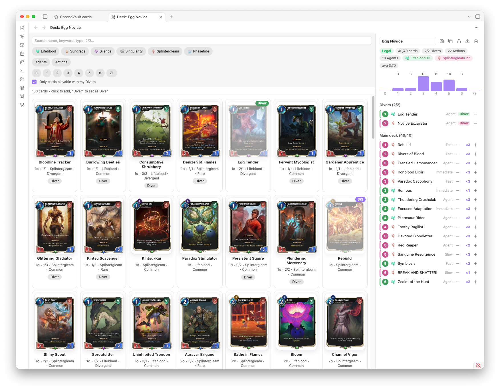
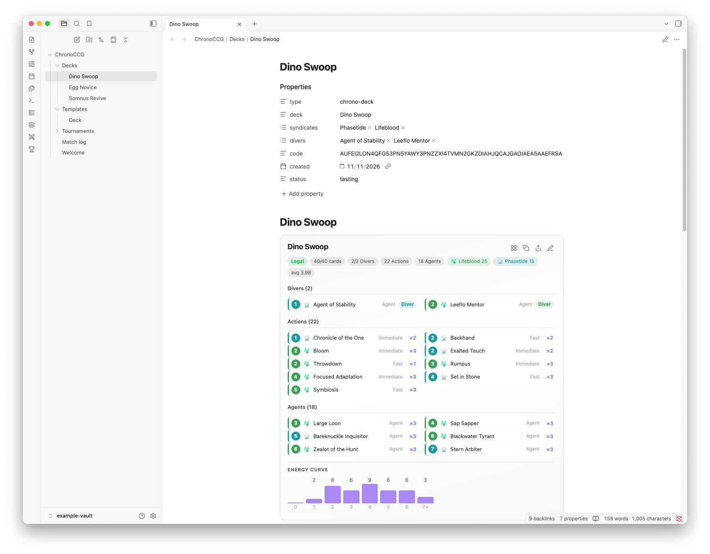
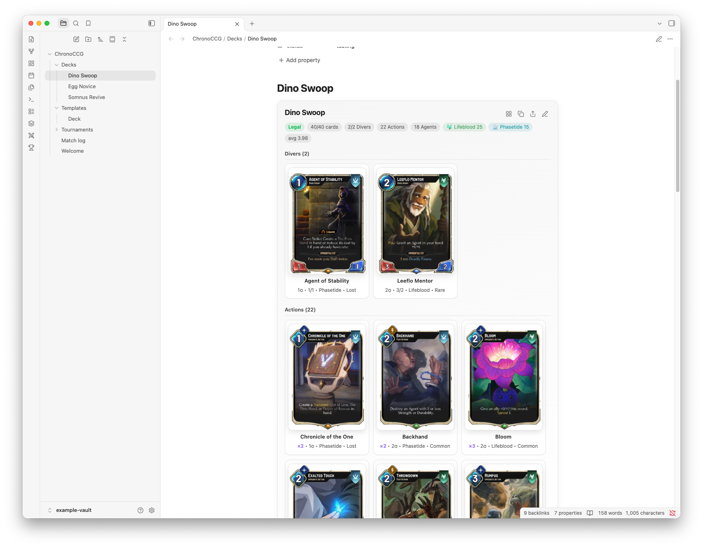
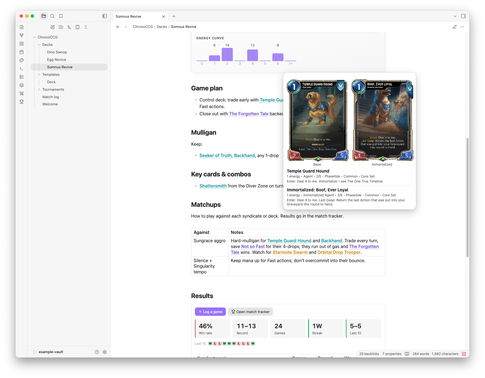
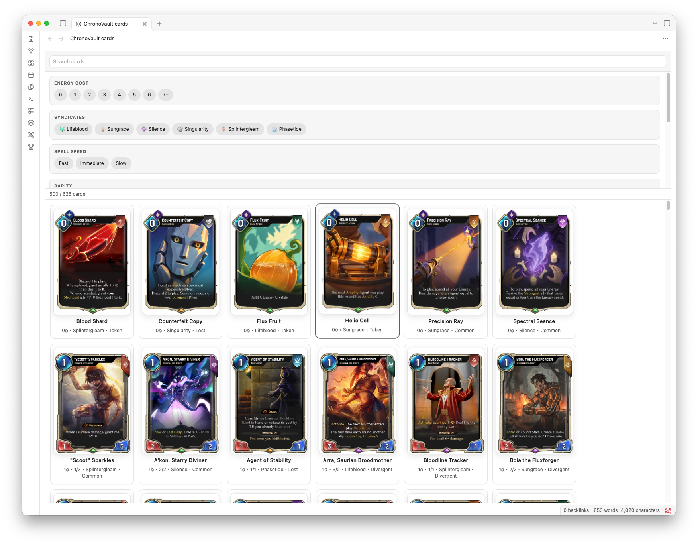
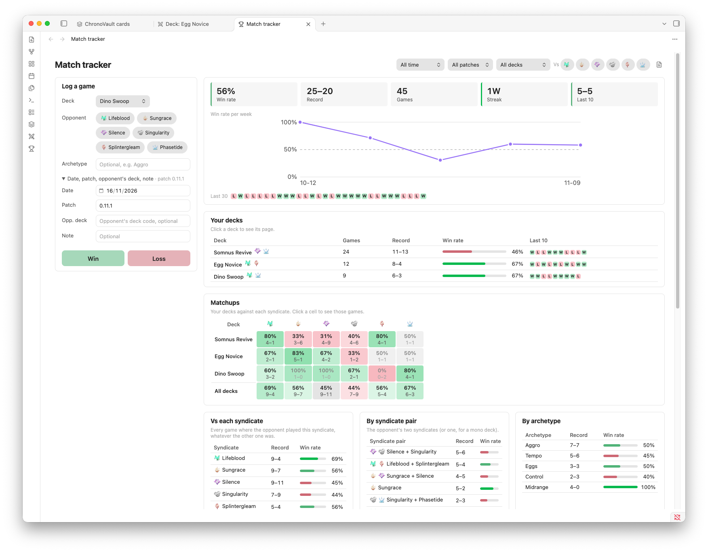
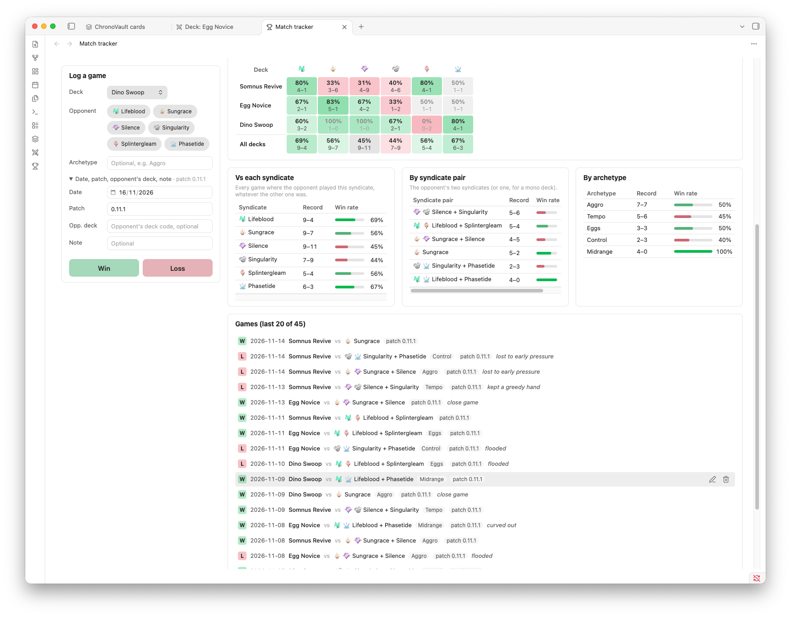
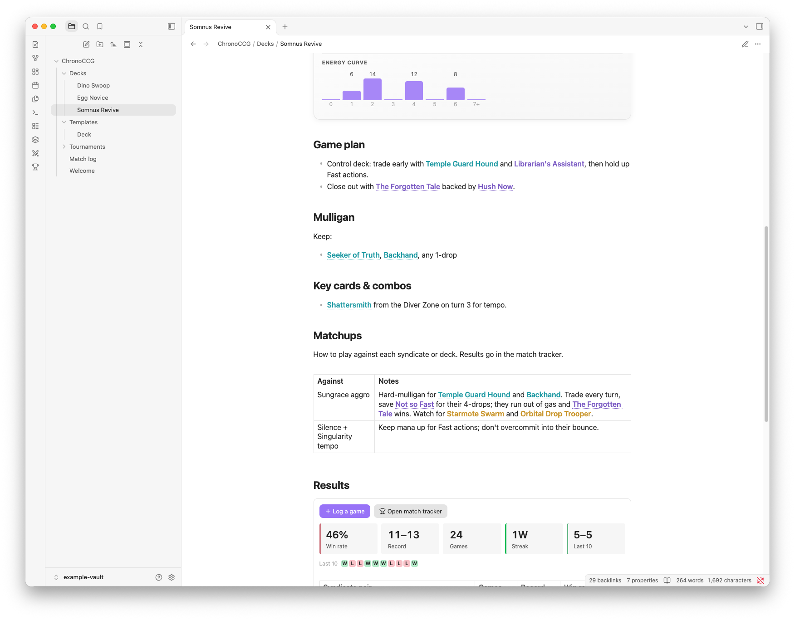

# ChronoVault

ChronoVault is an Obsidian plugin for [ChronoCCG](https://playchrono.com/). I wanted to keep my decks and tournament reports in my vault, with real cards in them instead of plain text, so I made this.



If you cloned the repo, you can try it in the example vault: open `example-vault/` in Obsidian and start with `ChronoCCG/Welcome.md`.

## Contact me

You can contact me on the Chrono Discord or by DM: Wizz4rrd#5948

## What it does

- Inline card references: write `` `chrono:Hush Now` `` and you get the card name in its syndicate colour, with a preview on hover. Click it to open the card. Works in Reading view and Live Preview. For Agents that immortalize, the preview and the card window show both sides.
- Card images: put card names in a `chrono-card` block, one per line. Add a line with `full` if you want them big.
- Decks: a `chrono-deck` block takes a deck code, a simple list or YAML (examples below). It checks the deck against the [rules](https://playchrono.com/rules) (2 Divers, 40 cards, max 3 copies, only your Divers' syndicates), shows the energy curve and the type/syndicate split, and has buttons to copy the code, export the deck or open it in the builder.
- Deck builder: opens in its own tab. Filter the card pool (you can show only the cards your Divers can play), add/remove cards, and save the deck back to the note it came from or to a new note. Saving a deck note also updates its properties and adds what changed to its "Changelog" section. While building you can go past the limits (more than 40 cards, more than 3 copies, cards outside your Divers' syndicates): the deck shows as not legal, and saving asks first.
- Card browser: a page or a sidebar pane with filters for cost (click one or more, 0 to 7+), syndicate, spell speed, rarity, type, keyword and set. The deck builder has the same cost filter. Click a card to insert it, add it to the builder or see the details.
- Match tracker: log your games (deck, the opponent's syndicates, optionally archetype, patch, the opponent's deck code and a note) and see your win rates per deck, per syndicate and per syndicate pair, a matchup grid, and a chart per week. Games are saved in a note, as a table you can also edit by hand.
- Templates for deck notes and tournament reports (with several decks and Bo1/Bo3/Bo5 rounds). The frontmatter works with Dataview. You can replace them with your own.

Deck codes work both ways with the game and with deck sites that use the same format.

If a card can't be found (typo, or a card that isn't in the data yet), it shows up as a grey "?" card instead of disappearing.

| | |
| --- | --- |
|  |  |
| A `chrono-deck` block in a deck note | The same block with card images |
|  |  |
| Hover preview of an Agent that immortalizes | The card browser |

### Syntax

````markdown
Inline: `chrono:Shattersmith` or `chrono:258`

```chrono-card
Sensory Deprivation Pod
Shattersmith
```

```chrono-deck
AUGVG33NNZ2XGICSMV3GS5TFBNRW63TTORZHKY3UMVSHUAACAEAAFBIBA4GGMAYMAMHAGCADNUBQEAYZAMBQGAQDAMBQEAYCAM
```

```chrono-deck
name: My deck
D Sensory Deprivation Pod
D Shattersmith
3 Librarian's Assistant
2 Hush Now
```

```chrono-deck
name: My deck
divers: [122, 258]
cards:
  - { id: 102, count: 3 }
  - { name: Hush Now, count: 2 }
```
````

### Commands

| Command | |
| --- | --- |
| Open card browser / Open deck builder | Also in the ribbon. The card browser opens as a page or in the sidebar (settings, or "Move to sidebar" / "Open as page" in its tab menu) |
| Start a new deck in the builder | Asks first when the builder has cards in it |
| Save deck in builder | Same as the builder's save button, so you can give it a hotkey |
| Edit deck block in builder | Put the cursor inside a `chrono-deck` block first |
| Copy deck code | Of the `chrono-deck` block under the cursor, or the note's first one |
| Import deck from code… | Open it in the builder, insert it in the note, or make a deck note |
| Insert inline card reference… / Insert card image block… | |
| Look up a card… | |
| New deck note | Also opens the deck builder, linked to the new note |
| New tournament report | Asks for the event, the format (Bo1, Bo3, Bo5), the number of rounds and the decks you bring: any number of deck notes (from the notes folder), plus deck codes (one per line) for decks you have no note for |
| Open match tracker | Also in the ribbon (trophy). From a deck note, opens that deck's page |
| Record match result… | Logs a game without opening the tracker. From a deck note, that deck is picked |
| Open match log note | The note the games are saved in |
| Update deck note properties | Sets `deck`, `syndicates`, `divers` and `code` from the note's first deck block |
| Refresh card database | Downloads the card list again |

### Templates

New notes go in `ChronoCCG/Decks` and `ChronoCCG/Tournaments` (you can change the root folder in the settings).

In a deck note (`type: chrono-deck`), the `deck`, `syndicates`, `divers` and `code` properties describe the first `chrono-deck` block. Saving from the deck builder updates them. If you edit the block by hand, the block shows "Note properties are out of date" with an Update button (or run "Update deck note properties"). Properties your template doesn't have are left alone.

Saving a deck note from the deck builder also adds a line to its "Changelog" section, e.g. ``- 2026-11-14 — Diver `chrono:Agent of Stability` → `chrono:Leeflo Mentor`, +2 `chrono:Bloom`, −1 `chrono:Throwdown` ``. Saves on the same day are merged into one line. Notes without a "Changelog" heading are left alone, and you can turn this off in the settings ("Log deck changes"). To edit the templates, click "Write templates" in the settings (Notes → Default templates) and change the files it creates. Placeholders: `{{name}} {{date}} {{deck}} {{code}} {{divers}} {{syndicates}}`, and in tournament reports `{{event}} {{format}} {{decks}}` (for the `decks` property) `{{deckLinks}} {{decklists}} {{rounds}}`. A tournament report has a section per round with a row per game, to note which of your decks you played.

### Match tracker



Games go in one note, `ChronoCCG/Match log.md` by default (you can change it in the settings), as a table with a row per game: date, patch, deck (a link to the deck note), result (W or L), the opponent's syndicates, archetype, the opponent's deck code and a note. You can edit it by hand, and columns are found by their name, so you can reorder them or add your own. Deck links show the deck's name (`[[Decks/Egg Novice|Egg Novice]]`), you can turn that off in the settings ("Deck names in the match log"). In the note, `` `chrono:Hush Now` `` works like anywhere else, and the tracker's game list shows it as a card reference too.

In the tracker:
- Filters: period, patch, deck, and "Vs": pick one syndicate for every game against it (whatever the other one was), or two for that pair.
- With all decks: your decks, the matchup grid (your decks × the six syndicates, plus all decks together), and your record against each syndicate and each syndicate pair. Click a deck, a row or a cell to narrow it down.
- With one deck: that deck's page.
- The archetype is free text. It suggests the archetypes you used before, and typing one in another case ("aggro") keeps the spelling you used first, so it isn't counted twice.
- The deck is the one of your last game, and the patch the last one you logged. Pasting the opponent's deck code sets their syndicates from the Divers, and the game list has a button to open it in the deck builder (no note is created).



Colours in the matchup grid: red is a win rate under 45%, grey is 45–55% (about even), green is over 55%. The further from 50%, the stronger the colour. A faded cell (or a faded row in the tables) has fewer than 3 games, so the win rate doesn't say much yet. The win-rate bars go red under 40%, light red 40–50%, light green 50–60% and green from 60%.

A `chrono-matches` block (with nothing in it) shows a deck's results in its note: win rate, record, last 10 games and the record against each syndicate pair (most played first), with buttons to log a game and open the tracker. New deck notes have one in their "Results" section. Anywhere else (e.g. the match log) it shows every game.



### Deck notes in a base

Deck notes work well in a [base](https://obsidian.md/help/bases) (filter on `type == "chrono-deck"`). The plugin adds a "ChronoVault decks" view type to bases: a table where the Divers show as inline card references (coloured, with the hover preview; click to open the card) and the syndicates as their icons (saved, so they also show offline). Pick it in the base's view menu. In the view options, "Card properties" sets which properties hold card names (`divers` by default) and "Syndicates property" which one holds syndicates. Columns, sorting, filters and grouping are set like in a normal table. The example vault has one: `ChronoCCG/Decks/Decks.base`.

### Limitations

- Needs Obsidian 1.14.4 or later.
- Mobile (iPad, Android tablets, phones) is not tested yet. The deck builder has a touch layout for tablets, but expect rough edges on mobile, and please report what you find.

## Network use

The plugin only goes online to get the card list, the card images and the six syndicate icons, from the official public data that Chronoverse Games Studio publishes on its CDN and website. It doesn't send anything about you or your vault.

| When | What | Where |
| --- | --- | --- |
| At startup, if the card list is older than the refresh interval (7 days by default) | Downloads the card list (one file per set) | `cdn.playchrono.com` |
| When you run "Refresh card database" | Same | `cdn.playchrono.com` |
| The first time a card image is shown | Downloads the image (about 1.3 MB) | `cdn.playchrono.com` |
| When you click "Download all card images" in the settings | Downloads every card image that isn't saved yet | `cdn.playchrono.com` |
| The first time a syndicate icon is shown | Downloads the icon (about 3 KB) | `playchrono.com` |
| If you set a custom data URL | Downloads the card list | Your URL |

The card list (`card-cache.json`) is saved in the plugin folder. The images and icons are saved in a `ChronoVault` folder in your attachment folder (Settings → Files and links), so they sync with the vault and devices with their own config folder share them. You can keep them in the plugin folder instead (`image-cache/`, setting "Card image folder"); changing it moves the saved images. Each image is only downloaded once and everything you've already seen works offline. Saved images are shrunk to 400px wide WebP (about 35 KB each, roughly 14 MB for all 390 deck-legal cards). To have every card offline at once, use "Download all card images" in the settings: it downloads the missing ones (a few at a time, you can cancel) and saves the same 400px copies. You can clear the saved images in the settings, or turn off saving them: that deletes them too (after asking), and the full-size image is then loaded every time. Set the auto-refresh interval to `0` to turn off the automatic download. If you pick the "Bundled" source it never downloads anything (syndicate icons are replaced by plain icons), but you only get a placeholder card.

## Privacy and permissions

- **Vault:** the plugin reads the notes it renders and the deck notes in its notes folder (for the tournament report and match tracker deck lists) and the match log, and writes only the notes you create or save from it (including the match log), plus its own folder (`card-cache.json`, settings) and the folder for card images (`ChronoVault` in the attachment folder, or `image-cache/` in its own folder). It doesn't scan the rest of your vault.
- **Clipboard:** it only writes to the clipboard when you click a copy button or command (deck code, export, inline card reference). It never reads the clipboard.
- **Release files:** `main.js`, `manifest.json` and `styles.css` of each release are built by GitHub Actions from this repository and come with a [build provenance attestation](https://docs.github.com/actions/security-for-github-actions/using-artifact-attestations). Check a download with `gh attestation verify main.js --repo Wizz4rrd/obsidian-chronovault`.

## Plans

- Tested mobile support (tablets first)
- Import games from the game's replay files
- More customisation possiblities for the Match tracker page

## Development

Everything runs in Docker (`node:20-alpine`), so you don't need Node installed. `./plugin` is mounted in the container, so the build output ends up in `plugin/`.

```bash
make install     # npm install (builds the image the first time)
make dev         # rebuild on save
make build       # production build
make test        # unit tests
make lint        # ESLint with Obsidian's plugin rules
make link        # symlink plugin/ into example-vault/.obsidian/plugins/chronovault
make shell       # shell in the container
make help        # all targets
```

After `make link`, turn on ChronoVault in Settings → Community plugins in the example vault. Reload the plugin after each build, or use the Hot Reload plugin.

```
.
├── manifest.json / versions.json   copies for Obsidian's plugin list
├── plugin/
│   ├── main.ts
│   ├── src/
│   │   ├── data/       card data, deck codes, parsing, rules, export
│   │   ├── markdown/   chrono-card / chrono-deck blocks, inline refs
│   │   ├── ui/         card browser, deck builder, previews, modals
│   │   ├── templates/
│   │   └── settings/
│   ├── tests/
│   └── scripts/        test runner, version bump
├── example-vault/      vault for testing, with example notes (not shipped)
├── .github/workflows/  CI and release
└── Dockerfile / docker-compose.yml / Makefile
```

### Releasing

1. `cd plugin && npm version patch` (or `minor` / `major`). This updates both `manifest.json` files and `versions.json`.
2. Push the tag (e.g. `1.0.1`, no `v`). The Release workflow builds, runs the tests and makes a draft GitHub release with `main.js`, `manifest.json` and `styles.css`.
3. First release only: submit the repo to [obsidian-releases](https://github.com/obsidianmd/obsidian-releases).

Betas: set the beta version (e.g. `2.1.0-beta.1`) by hand in `plugin/manifest.json` and `plugin/package.json` only, and push the tag. The root `manifest.json` is the one Obsidian reads for updates, so it stays on the last stable version and nobody gets the beta by accident. The release is marked as a pre-release. Testers install it with [BRAT](https://github.com/TfTHacker/obsidian42-brat) ("Add beta plugin", the repo URL, then pick the version), or by copying `main.js`, `manifest.json` and `styles.css` into `.obsidian/plugins/chronovault/`.

## Use of AI

I used AI coding tools (Claude Code) while building this plugin, the same way I'd use any other dev tool. I decided what the plugin does and how it works, reviewed the code, and tested it in my own vault. If you find something that looks off, please open an issue.

## Credits

- [ChronoCCG](https://playchrono.com/), the game, and its official public data on `cdn.playchrono.com`, for the card data and images

This is an unofficial fan project. It isn't affiliated with or endorsed by Chronoverse Games Studio, who make ChronoCCG. Card names, images and text belong to them. The MIT license only covers the plugin's code.

## License

MIT, see [LICENSE](LICENSE).
